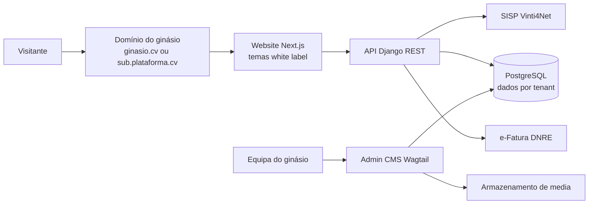
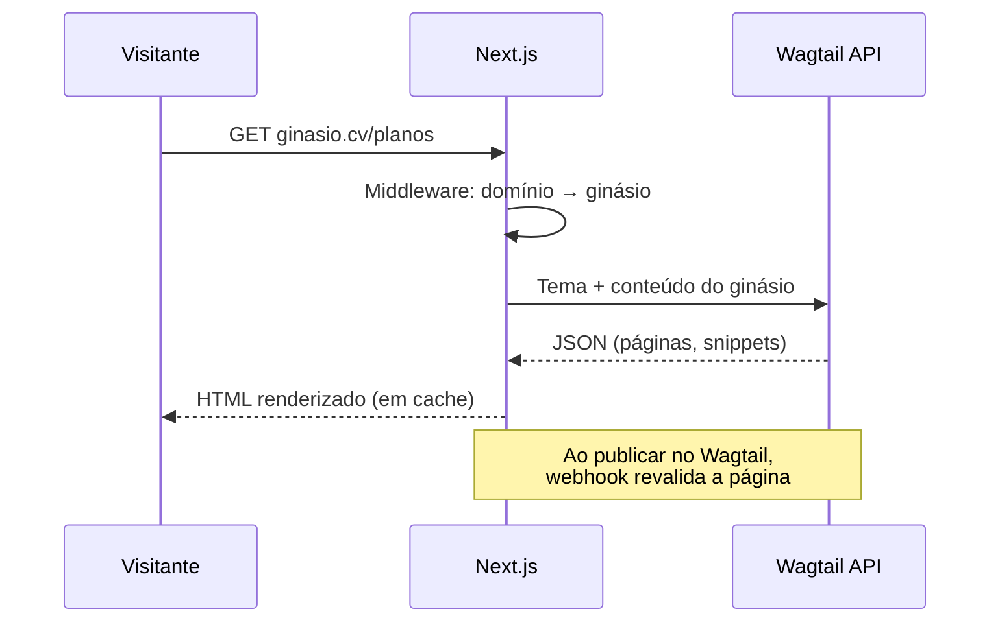

# Roadmap — Plataforma White Label para Ginásios

Última atualização: 24/09/2026 · Equipa: Adilson Correia e Adilson Monteiro

Este ficheiro junta os dois roadmaps do projeto:

1. **Roadmap geral** — visão do produto, integrações, arquitetura e decisões.
2. **Roadmap detalhado do Site e do Admin** — plano por sprints, modelo de conteúdo, rotas, infraestrutura e qualidade.

---

# Parte 1 — Roadmap geral

## Visão geral

O foco atual é entregar o website white label de cada ginásio (Next.js) e o Admin CMS onde o ginásio gere esse conteúdo (Django + Wagtail), em cerca de 20 semanas até ao piloto.

- **Produto:** plataforma SaaS white label para ginásios — cada ginásio tem o seu site, a sua marca e o seu domínio, servidos pela mesma plataforma.
- **Mercado inicial:** Cabo Verde (Praia e Mindelo primeiro); Portugal como expansão posterior.
- **Stack:** Django + Wagtail (Admin CMS + API) e React com Next.js (website), postgresql e docker.
- **Premissa de planeamento:** 2 programadores a tempo inteiro; prazos indicativos.

## Decisões técnicas (fechadas)

| Tema | Decisão | Motivo |
| --- | --- | --- |
| Framework do site | Next.js | Renderização no servidor para SEO e velocidade, continua a ser React |
| Isolamento dos dados | Tabelas partilhadas com chave de tenant | Mais simples de operar e de migrar |
| Admin CMS | Wagtail | Páginas por blocos (StreamField), multi-site nativo, também Django |
| Domínios | Domínio próprio por ginásio desde o piloto | Implica emissão automática de certificados SSL |

## Integrações e conformidade (Cabo Verde)

A equipa já tem experiência de implementação com SISP, e-Fatura e CNPD, por isso estas integrações entram no roadmap como trabalho conhecido e não como risco.

| Área | O que a plataforma precisa | Impacto no site e no CMS |
| --- | --- | --- |
| SISP / Vinti4 | Pagamento online (Vinti4Net) para adesão e mensalidades; registo de pagamentos presenciais (numerário, TPA, transferência) | Botão de adesão com pagamento no site; configuração das credenciais SISP por ginásio no CMS |
| e-Fatura (DNRE) | Emissão de fatura eletrónica em cada pagamento; certificado digital ICP-CV por ginásio (cada ginásio é o emissor) | Gestão do certificado e dos dados fiscais do ginásio no CMS; fatura enviada automaticamente após pagamento no site |
| CNPD | Conformidade com a lei de proteção de dados de Cabo Verde | Consentimentos nos formulários do site, política de privacidade por ginásio, exportação e eliminação de dados no CMS |
| Outros | Moeda CVE, língua portuguesa; lembretes por WhatsApp/SMS | Campos de preço em CVE; integração de mensagens na fase de crescimento |

Preparar desde o início os módulos de pagamento e faturação como plugáveis por país, para a entrada em Portugal (MB Way, SEPA, faturação AT) não obrigar a reescrever o núcleo.

## Arquitetura do site e do Admin CMS

Um único backend Django serve todos os ginásios; o site Next.js lê o conteúdo por API e aplica a marca de cada ginásio a partir do domínio de onde é acedido.

**Backend Django**

- Django + Django REST Framework para a API pública do site.
- Multi-tenancy: identificação do ginásio pelo domínio (subdomínio da plataforma ou domínio próprio), com tabelas partilhadas e chave de tenant em cada registo (filtragem automática por ginásio).
- Admin CMS em Wagtail (páginas por blocos com StreamField), com permissões por ginásio e por perfil (dono, gestor, rececionista, treinador).
- Conteúdo com estados rascunho / publicado e pré-visualização antes de publicar.
- Media (logótipos, fotos, galerias) em armazenamento compatível com S3, com redimensionamento de imagens.

**Website Next.js**

- Componentes reutilizáveis (hero, planos, horário, equipa, galeria, testemunhos, FAQ, contactos) montados a partir dos blocos definidos no CMS.
- Tema por ginásio via variáveis de design (cores, tipografia, logótipo) carregadas da API.
- Renderização no servidor para SEO e velocidade.
- Leve e rápido em ligações móveis fracas.

## Fases do Site e do Admin CMS

Seis fases levam do zero a um ginásio piloto com site próprio em produção por volta da semana 20; o CMS e o site avançam em paralelo a partir da semana 5.

| Fase | Semanas | Admin CMS | Website | Critério de saída |
| --- | --- | --- | --- | --- |
| 1. Fundação | 1–4 | Projeto Django + Wagtail, PostgreSQL, multi-tenancy por domínio, autenticação e perfis por ginásio, API base, auditoria | Projeto Next.js, estrutura de componentes, sistema de temas, ligação à API | Dois ginásios de teste isolados, cada um com o seu domínio e tema |
| 2. CMS núcleo | 5–10 | Marca (logótipo, cores, contactos, redes sociais, horário de funcionamento); modalidades, horário de aulas, planos em CVE, treinadores, galeria, testemunhos, FAQ; media; SEO; rascunho/publicado | — | Um gestor sem ajuda técnica configura todo o conteúdo de um ginásio |
| 3. Website | 7–12 | Pré-visualização do site a partir do CMS; páginas por blocos | 2 a 3 modelos de site; páginas Início, Modalidades, Horário, Planos, Equipa, Galeria, Contactos; SEO, desempenho, analítica | Site de um ginásio de teste completo, só com conteúdo do CMS |
| 4. Conversão | 13–16 | Leads e pré-inscrições; configuração SISP e e-Fatura por ginásio; consentimentos e pedidos de dados (CNPD) | Formulário de contacto, aula experimental, adesão online com Vinti4Net e fatura automática | Adesão paga do início ao fim, com fatura válida |
| 5. Piloto | 17–20 | Onboarding do piloto, formação, ajustes de usabilidade | Domínio próprio, SSL, migração de conteúdo, correções | Site do piloto em produção, gerido pela equipa do ginásio |
| 6. Evolução | 21+ | Construtor visual, agendamento de publicações, histórico de versões, blog, onboarding self-service | Novos modelos, blog, PT/EN para zonas turísticas, testes A/B | Novo ginásio em produção sem intervenção da equipa |

As fases 2 e 3 sobrepõem-se de propósito: assim que um tipo de conteúdo existe no CMS, o componente correspondente do site é construído logo a seguir, o que expõe cedo falhas no modelo de conteúdo.

## Roadmap geral da plataforma

O site e o CMS são a primeira peça de uma plataforma maior de gestão de ginásios; as restantes fases ficam registadas para referência.

| Fase | Duração | Foco |
| --- | --- | --- |
| 0. Descoberta | 3–4 semanas | Entrevistas a ginásios na Praia e no Mindelo; como faturam e cobram hoje; 1 a 2 ginásios piloto |
| 1. Fundação | 4–6 semanas | Multi-tenant, perfis e acessos, CVE e português, preparação para vários países |
| 2. MVP de gestão | 8–10 semanas | Sócios e planos, pagamentos presenciais, e-Fatura, check-in QR tolerante a falhas de rede, lembretes WhatsApp/SMS, app do sócio |
| 3. Piloto | 6–8 semanas | 1 a 2 ginásios na Praia, acompanhamento presencial |
| 4. Crescimento | 3–4 meses | Pagamento Vinti4Net na app, marcação de aulas, planos de treino, relatórios |
| 5. Expansão | contínuo | Outras ilhas, ginásios de hotéis no Sal e na Boa Vista, depois Portugal |

**App do sócio com a marca de cada ginásio:** uma app por ginásio nas lojas (mais premium, mais trabalho de publicação) ou uma app única onde a marca muda consoante o ginásio (mais simples de manter). Sugestão: começar pela app única e vender a app própria como plano superior.

---

# Parte 2 — Roadmap detalhado do Site e do Admin

## Plano por sprints

Dez sprints de 2 semanas levam do projeto vazio ao ginásio piloto em produção na semana 20, com três marcos: site de teste completo (semana 12), adesão paga ponta a ponta (semana 16) e go-live do piloto (semana 20).

| Sprint | Semanas | Admin (Wagtail) | Site (Next.js) | Entregável |
| --- | --- | --- | --- | --- |
| S1 | 1–2 | Projeto Django + Wagtail, PostgreSQL, Docker; modelo Ginásio ligado a um Site do Wagtail | Projeto Next.js (App Router, TypeScript), cliente da API, estrutura de componentes | Ambientes dev e staging a correr, CI com testes |
| S2 | 3–4 | Isolamento por tenant (managers, middleware), grupos e permissões por ginásio, auditoria | Middleware que resolve o domínio para o ginásio; tema dinâmico via API | Dois ginásios de teste isolados, cada um no seu domínio com SSL |
| S3 | 5–6 | Configurações da marca; biblioteca de media em S3; página inicial com blocos (hero, texto, CTA, galeria) | Layout base, cabeçalho e rodapé, renderização dos blocos da página inicial | Página inicial editável no CMS e visível no site |
| S4 | 7–8 | Snippets: Modalidades, Treinadores, Planos (CVE), Testemunhos, FAQ | Páginas Modalidades, Equipa e Planos; componentes de testemunhos e FAQ | Conteúdo principal gerível sem programador |
| S5 | 9–10 | Horário de aulas; fluxo rascunho/publicado; pré-visualização | Página Horário com filtros; modo de pré-visualização; revalidação ao publicar | Gestor vê a alteração antes de publicar e o site atualiza em segundos |
| S6 | 11–12 | SEO, redirecionamentos, sitemap e robots por ginásio; 2.º e 3.º modelos de site | SEO técnico, otimização de imagens, analítica, acessibilidade, desempenho | **Marco:** site de teste completo |
| S7 | 13–14 | Caixa de leads, notificações email/WhatsApp, consentimentos e pedidos de dados (CNPD) | Formulários de contacto e aula experimental, aviso de cookies, política de privacidade | Pedidos do site chegam ao ginásio com consentimento registado |
| S8 | 15–16 | Configuração SISP e e-Fatura por ginásio; lista de adesões e pagamentos | Fluxo de adesão online com Vinti4Net, confirmação e fatura | **Marco:** adesão paga ponta a ponta |
| S9 | 17–18 | Onboarding do piloto, migração de conteúdo, formação | Domínio próprio do piloto, monitorização de erros, ajustes | Site do piloto em produção |
| S10 | 19–20 | Correções do feedback, manual do utilizador, teste de restauro de backups | Correções, afinação de desempenho | **Marco:** go-live |

Sugestão de divisão: um sócio lidera o Admin e o outro o Site, com revisão cruzada de código em todos os sprints.

## Backlog por sprint

Lista de tarefas para acompanhar a implementação. Marcar à medida que avançam.

### S1 — Arranque (semanas 1–2)

- [ ] Repositórios (backend e site) com convenções de branches e PR
- [ ] Docker Compose: Django, PostgreSQL, Redis, Next.js
- [ ] Projeto Django + Wagtail + Django REST Framework
- [ ] Modelo `Ginasio` ligado a `wagtail.models.Site`
- [ ] Projeto Next.js (App Router, TypeScript), cliente da API tipado
- [ ] CI: lint, testes e build nos dois projetos
- [ ] Ambiente de staging acessível

### S2 — Multi-tenancy e acessos (semanas 3–4)

- [ ] Chave de tenant em todos os modelos de conteúdo próprios
- [ ] Manager/queryset base que filtra sempre pelo ginásio atual
- [ ] Middleware Django que resolve o ginásio pelo domínio
- [ ] Grupos e permissões por ginásio (dono, gestor, rececionista, treinador)
- [ ] Registo de auditoria das ações no Admin
- [ ] Middleware Next.js: domínio → ginásio
- [ ] Endpoint de tema (cores, fontes, logótipo) e variáveis CSS no site
- [ ] Caddy com TLS on-demand e endpoint de validação de domínio no Django
- [ ] Testes de isolamento: ler dados de outro ginásio tem de falhar
- [ ] Protótipo técnico de pré-visualização headless (reduz risco do S5)

### S3 — Marca e página inicial (semanas 5–6)

- [ ] Configuração da marca por site (logótipo, favicon, cores, tipografia, contactos, redes, horário de funcionamento)
- [ ] Armazenamento de media compatível com S3 e renditions de imagens
- [ ] Página inicial com StreamField: hero, texto, CTA, galeria
- [ ] Layout base do site: cabeçalho, rodapé, navegação
- [ ] Renderizador de blocos StreamField → componentes React

### S4 — Conteúdo estruturado (semanas 7–8)

- [ ] Snippets: Modalidade, Treinador, Plano (CVE), Testemunho, FAQ
- [ ] Endpoints da API para cada snippet, filtrados por ginásio
- [ ] Páginas `/modalidades`, `/modalidades/[slug]`, `/equipa`, `/planos`
- [ ] Componentes de testemunhos e FAQ
- [ ] Validar os blocos com o ginásio piloto

### S5 — Horário e publicação (semanas 9–10)

- [ ] Snippet Aula no horário (modalidade, dia, hora, treinador, sala, lotação)
- [ ] Página `/horario` com filtros por dia e modalidade
- [ ] Fluxo rascunho/publicado no Wagtail
- [ ] Pré-visualização: draft mode do Next.js + preview do Wagtail
- [ ] Webhook de publicação → revalidação por tags (ginásio + tipo de conteúdo)

### S6 — SEO, modelos e desempenho (semanas 11–12)

- [ ] Campos SEO por página e configuração SEO por site
- [ ] Redirecionamentos, sitemap e robots por domínio
- [ ] 2.º e 3.º modelos de site
- [ ] Otimização de imagens, analítica, acessibilidade
- [ ] Lighthouse ≥ 90 em desempenho e SEO (rede móvel)
- [ ] Pedir fotos e textos ao ginásio piloto
- [ ] **Marco:** site de teste completo, só com conteúdo do CMS

### S7 — Leads e privacidade (semanas 13–14)

- [ ] Modelo Lead (contacto, aula experimental) e caixa de leads no Admin
- [ ] Notificações por email e WhatsApp ao ginásio
- [ ] Registo de consentimento em todos os formulários
- [ ] Exportação e eliminação de dados a pedido (CNPD)
- [ ] Formulários no site, aviso de cookies, página `/privacidade`

### S8 — Adesão e pagamento (semanas 15–16)

- [ ] Configuração das credenciais SISP por ginásio (guardadas cifradas)
- [ ] Configuração e-Fatura por ginásio (dados fiscais, certificado ICP-CV)
- [ ] Fluxo `/aderir`: escolha do plano, dados, pagamento Vinti4Net
- [ ] Confirmação do pagamento e emissão automática da fatura
- [ ] Lista de adesões e pagamentos no Admin
- [ ] **Marco:** adesão paga do início ao fim, com fatura válida

### S9 — Piloto (semanas 17–18)

- [ ] Onboarding do ginásio piloto e migração de conteúdo
- [ ] Domínio próprio do piloto com SSL
- [ ] Sentry e monitorização de disponibilidade
- [ ] Formação da equipa do ginásio

### S10 — Estabilização e go-live (semanas 19–20)

- [ ] Correções a partir do feedback do piloto
- [ ] Manual do utilizador do Admin
- [ ] Teste de restauro de backups
- [ ] Afinação de desempenho
- [ ] **Marco:** go-live, gerido pela equipa do ginásio

## Admin CMS em Wagtail — modelo de conteúdo

Cada ginásio é um Site do Wagtail com a sua árvore de páginas; o conteúdo estruturado vive em snippets com chave para o ginásio, e a marca em configurações por site.

| Elemento | Tipo no Wagtail | Campos principais |
| --- | --- | --- |
| Ginásio | Modelo Django ligado a um Site | Nome, NIF, domínio, estado, plano da plataforma |
| Marca | Configuração por site | Logótipo, favicon, cores, tipografia, contactos, redes sociais, horário de funcionamento |
| Página inicial | Página com StreamField | Blocos: hero, texto, CTA, destaques, galeria, testemunhos, FAQ |
| Página genérica | Página com StreamField | Os mesmos blocos, para "Sobre", "Instalações", etc. |
| Modalidade | Snippet | Nome, descrição, imagem, nível, duração |
| Treinador | Snippet | Nome, foto, especialidades, biografia |
| Plano | Snippet | Nome, preço em CVE, periodicidade, benefícios, destaque |
| Aula no horário | Snippet | Modalidade, dia, hora, treinador, sala, lotação |
| Testemunho / FAQ | Snippet | Texto, autor ou pergunta/resposta, ordem |
| Lead | Modelo Django | Tipo (contacto, aula experimental), dados, consentimento, estado |
| SEO | Campos por página + configuração por site | Título, descrição, imagem de partilha, indexação |

**Perfis e permissões (por ginásio)**

- **Dono:** tudo, incluindo marca, pagamentos, faturação e utilizadores.
- **Gestor:** conteúdo, horário, planos e leads; sem configurações fiscais.
- **Rececionista:** leads e horário.
- **Treinador:** apenas o seu perfil e as suas aulas.
- **Equipa da plataforma:** superutilizador, com acesso auditado.

Os blocos do StreamField são o contrato entre Admin e Site: cada bloco novo exige o componente correspondente no Next.js.

## Site em Next.js

Uma única aplicação Next.js serve todos os ginásios: o domínio do pedido decide que ginásio, que tema e que conteúdo são mostrados.

O primeiro pedido gera a página e guarda-a em cache; ao publicar no Wagtail, um webhook revalida só as páginas afetadas desse ginásio.

| Rota | Conteúdo |
| --- | --- |
| `/` | Página inicial (blocos) |
| `/modalidades` e `/modalidades/[slug]` | Lista e detalhe de modalidades |
| `/horario` | Horário de aulas com filtros por dia e modalidade |
| `/planos` | Planos e preços em CVE, botão de adesão |
| `/equipa` | Treinadores |
| `/contactos` | Mapa, contactos, formulário |
| `/aderir` | Fluxo de adesão e pagamento Vinti4Net |
| `/[...slug]` | Páginas genéricas criadas no CMS |
| `/privacidade` | Política de privacidade do ginásio |

**Pontos técnicos**

- Middleware do Next.js lê o domínio e injeta o identificador do ginásio em todos os pedidos à API.
- Tema por ginásio aplicado com variáveis CSS geradas a partir da configuração da marca.
- Pré-visualização com o draft mode do Next.js ligado ao preview do Wagtail (ex.: wagtail-headless-preview).
- Revalidação sob pedido com tags por ginásio e por tipo de conteúdo.
- Sitemap, robots e metadados gerados por domínio.

## Infraestrutura

Tudo em contentores Docker atrás de um proxy com SSL automático, para que um ginásio novo com domínio próprio fique online só com a alteração do DNS.

| Componente | Escolha sugerida | Nota |
| --- | --- | --- |
| Proxy e SSL | Caddy com TLS on-demand | Antes de emitir o certificado, o Caddy pergunta ao Django se o domínio pertence a um ginásio ativo |
| Backend | Django + Wagtail com Gunicorn | API e Admin no mesmo serviço |
| Site | Next.js em Node (self-hosted) | Evita custos por domínio de plataformas geridas |
| Base de dados | PostgreSQL gerido ou com réplica | Backups diários e teste de restauro mensal |
| Media | Armazenamento compatível com S3 | Imagens redimensionadas pelo Wagtail |
| Cache | Redis | Cache da API e filas de tarefas (emails, webhooks) |
| CI/CD | GitHub Actions ou GitLab CI | Testes, build das imagens e deploy para staging e produção |
| Monitorização | Sentry + uptime | Alertas de erros e de sites em baixo |

Ambientes: desenvolvimento local, staging (com dois ginásios de teste) e produção. Onboarding de domínio próprio: o ginásio aponta o DNS, o Admin valida o domínio e o SSL é emitido no primeiro acesso.

## Qualidade e riscos

**Definição de pronto** (aplica-se a todas as tarefas)

- [ ] Testes automáticos, incluindo um teste que tenta ler dados de outro ginásio e tem de falhar.
- [ ] Lighthouse ≥ 90 em desempenho e SEO no site, medido em rede móvel.
- [ ] Acessibilidade básica: contraste, texto alternativo, navegação por teclado.
- [ ] Funciona com os três modelos de site e com cores de marca extremas.
- [ ] Revisão de código pelo outro sócio.

| Risco | Impacto | Mitigação |
| --- | --- | --- |
| Fuga de dados entre ginásios por falta do filtro de tenant | Muito alto | Filtro centralizado em managers, testes de isolamento obrigatórios no CI |
| Modelo de blocos muito rígido ou muito livre | Sites feios ou gestores perdidos | Validar os blocos com o ginásio piloto no S3 e S4 |
| Pré-visualização headless complexa | Atraso no S5 | Protótipo técnico logo no S2 |
| DNS mal configurado pelos ginásios | Atraso no go-live | Guia passo a passo e verificação automática no Admin |
| Conteúdo do piloto não chega a tempo | Site vazio no lançamento | Pedir fotos e textos no S6, com modelo a preencher |
